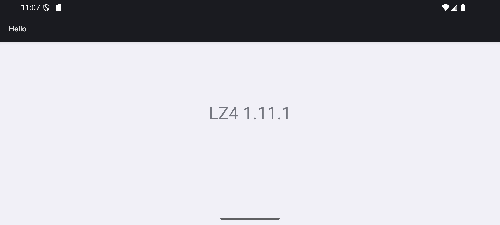
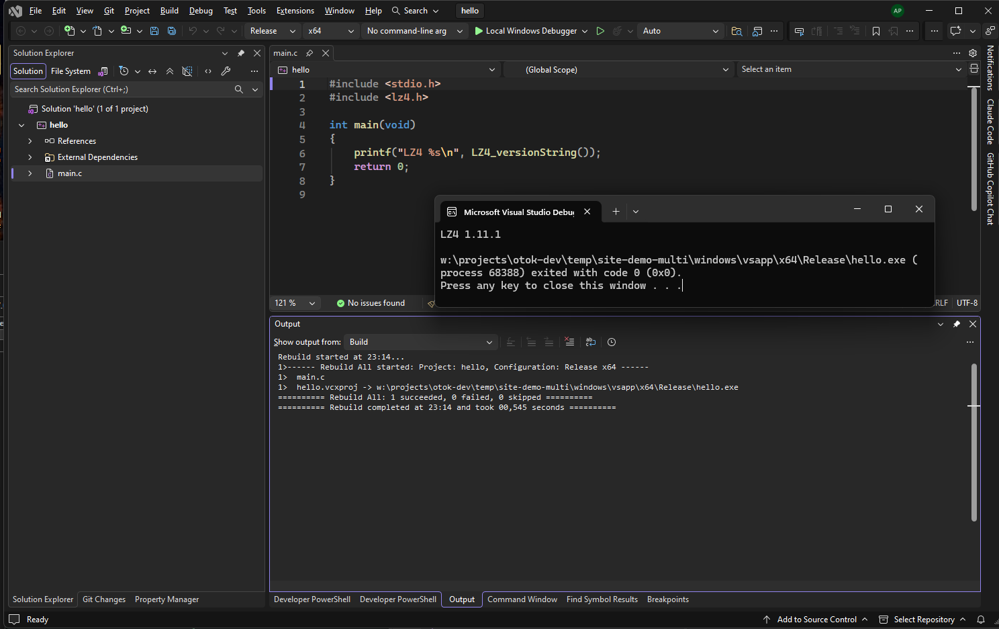

import { Card, CardGrid, LinkCard, Steps, Tabs, TabItem } from '@astrojs/starlight/components';
import { Image } from 'astro:assets';
import iphoneShot from '../../assets/iphone-lz4.png';
import xcodeIosShot from '../../assets/xcode-ios-lz4.png';

<CardGrid>
  <LinkCard title="Apple platforms" href="/start/apple/" description="XCFrameworks in a Swift package for Xcode and SwiftPM, and for CMake." />
  <LinkCard title="Android" href="/start/android/" description="Libraries for every ABI you ship, for the CMake of your Gradle build." />
  <LinkCard title="Windows" href="/start/windows/" description="Built with MSVC or clang-cl, for CMake and Visual Studio projects." />
  <LinkCard title="Linux" href="/start/linux/" description="Built with GCC or Clang against your system, for CMake." />
</CardGrid>

## One file, every platform

<Steps>

1. List your libraries once, and the targets you ship:

   ```toml
   [otok]
   format = 1

   [apple]
   platforms = ["ios", "iossim", "macosx"]
   deployment = { ios = "17.0", macos = "14.0" }
   output = "apple/Otok"

   [android]
   architectures = { android = ["arm64-v8a", "x86_64"] }
   deployment = { android = "24" }
   output = "android/Otok"

   [windows]
   build-on = ["windows/msvc"]
   output = "windows/Otok"

   [linux]
   build-on = ["linux/gcc"]
   output = "linux/Otok"

   [deps.lz4]
   recipe = "apotocki/lz4"
   version = "~> 1.10"
   ```

2. Run `otok install` on each machine. It builds the targets that machine can build, and says why it skips the others:

   <Tabs syncKey="build-machine">
   <TabItem label="Mac">
   ```text
   $ otok install
   otok.lock created:
     added lz4@android 1.11.1 (r3)
     added lz4@apple 1.11.1 (r2)
     ...
   note: not building for 'windows': this project builds 'windows' in windows/msvc; this machine is macos-arm64
   note: not building for 'linux': this project builds 'linux' in linux/gcc; this machine is macos-arm64
   toolchain of 'apple': Xcode 27.2 (27B52) at '/Applications/Xcode.app/Contents/Developer'
   toolchain of 'android': Android NDK 30.0.16248370 at '…/ndk.r30'
   ...
   output 'apple/Otok': 1 copied, 0 unchanged, 0 removed
   output 'android/Otok': 1 copied, 0 unchanged, 0 removed
   ```
   </TabItem>
   <TabItem label="Windows">
   ```text
   > otok install
   ...
   note: not building for 'apple': this otok does not build it on this machine
   note: not building for 'linux': this project builds 'linux' in linux/gcc; this machine is windows-x86_64
   toolchain of 'windows': Visual Studio 18.0 at 'C:\Program Files\Microsoft Visual Studio\18\Community' (MSVC 14.52.37025, Windows SDK 10.0.26100.0)
   toolchain of 'android': Android NDK 30.0.16248370 at '…/android-ndk-r30'
   ...
   output 'android/Otok': 1 copied, 0 unchanged, 0 removed
   output 'windows/Otok': 1 copied, 0 unchanged, 0 removed
   ```
   </TabItem>
   <TabItem label="Linux">
   ```text
   $ otok install
   ...
   note: not building for 'apple': this otok does not build it on this machine
   note: not building for 'windows': this project builds 'windows' in windows/msvc; this machine is linux-x86_64
   toolchain of 'linux': gcc (Ubuntu 15.2.0-16ubuntu1) 15.2.0
   toolchain of 'android': Android NDK 30.0.16248370 at '…/ndk.r30'
   ...
   output 'android/Otok': 1 copied, 0 unchanged, 0 removed
   output 'linux/Otok': 1 copied, 0 unchanged, 0 removed
   ```
   </TabItem>
   </Tabs>

   `otok.lock` pins the same version, recipe and source on every machine: commit it, and CI builds exactly that.

3. Use the libraries the way each platform's build expects:

   <Tabs syncKey="platform">
   <TabItem label="iPhone" icon="apple">
   Add `apple/Otok` to your app's Xcode project once (**File → Add Package Dependencies… → Add Local…**), add the
   product **LZ4** to the app target, and `import LZ4`:

   <div style={{ display: 'flex', gap: '1rem', alignItems: 'flex-start' }}>
     <Image src={xcodeIosShot} width={1080} alt="Xcode with the iOS app Hello: HelloApp.swift imports LZ4 from the local package Otok, running on an iPhone" style={{ flex: '1.636 1 0', minWidth: 0, height: 'auto', marginTop: 0 }} />
     <Image src={iphoneShot} width={585} alt="The app on the iPhone shows LZ4 1.11.1" style={{ flex: '0.462 1 0', minWidth: 0, height: 'auto', marginTop: 0, border: '1px solid var(--sl-color-gray-5)', borderRadius: '0.75rem' }} />
   </div>
   </TabItem>
   <TabItem label="macOS" icon="apple">
   The same directory serves a Mac app, or a Swift package that depends on it:

   ```swift
   import LZ4

   print("LZ4 \(String(cString: LZ4_versionString()))")
   ```

   
   </TabItem>
   <TabItem label="Android" icon="mobile-android">
   The CMake of your app's native library, `android/app/src/main/cpp/CMakeLists.txt`:

   ```cmake
   find_package(Otok CONFIG REQUIRED PATHS "${CMAKE_SOURCE_DIR}/../../../../Otok" NO_DEFAULT_PATH NO_CMAKE_FIND_ROOT_PATH)
   target_link_libraries(hello PRIVATE otok::LZ4)
   ```

   `otok::LZ4` brings the library of the ABI Gradle builds; an ABI that was not built is an error naming the cure.

   
   </TabItem>
   <TabItem label="Windows" icon="seti:windows">
   ```cmake
   find_package(Otok CONFIG REQUIRED PATHS "${CMAKE_SOURCE_DIR}/windows/Otok" NO_DEFAULT_PATH NO_CMAKE_FIND_ROOT_PATH)
   target_link_libraries(hello PRIVATE otok::LZ4)
   otok_copy_runtime_dlls(hello)
   ```

   ```text
   > cmake -S . -B build -A x64
   > cmake --build build --config Release
   > build\Release\hello.exe
   LZ4 1.11.1
   ```

   A Visual Studio project imports `otok.props` and `otok.targets` instead, and names the products it links:

   ```xml
   <Import Project="windows\Otok\otok.props" />
   <!-- the project's configurations and settings -->
   <PropertyGroup>
     <OtokProducts>LZ4</OtokProducts>
   </PropertyGroup>
   <!-- the project's sources, Microsoft.Cpp.targets -->
   <Import Project="windows\Otok\otok.targets" />
   ```

   
   </TabItem>
   <TabItem label="Linux" icon="linux">
   ```cmake
   find_package(Otok CONFIG REQUIRED PATHS "${CMAKE_SOURCE_DIR}/linux/Otok" NO_DEFAULT_PATH NO_CMAKE_FIND_ROOT_PATH)
   target_link_libraries(hello PRIVATE otok::LZ4)
   ```

   ```text
   $ cmake -S . -B build
   $ cmake --build build
   $ ./build/hello
   LZ4 1.11.1
   ```
   </TabItem>
   </Tabs>

</Steps>

Step by step for each target: [Apple platforms](/start/apple/), [Android](/start/android/),
[Windows](/start/windows/), [Linux](/start/linux/); several at once in [Several targets in one project](/guides/targets/).

## Why it is different

<CardGrid>
  <Card title="Your build of every library" icon="setting">
    Not a binary someone built once with their choices: otok builds each library from source for your app, with the
    options you ask for, your platforms and minimum OS versions, static or dynamic, your C++ standard, your flags, and
    your compilers: Xcode, the NDK, Visual Studio, GCC or Clang.
  </Card>
  <Card title="One file says everything" icon="document">
    Libraries, versions, options, targets, flags and profiles are all in `otok.toml`, and nothing else changes what is
    built: no triplets, overlays or environment variables to read besides it. An app for iOS and Android keeps one
    list of native libraries, at the same versions.
  </Card>
  <Card title="Native to each build" icon="puzzle">
    A Swift package for Xcode, `otok-config.cmake` for CMake on every platform, props for Visual Studio, shared
    objects Gradle packs into the APK, and `find_package(ZLIB)` answered as before. otok writes one directory per
    target and never touches your project files.
  </Card>
  <Card title="Every input pinned" icon="approve-check">
    `otok.lock` pins every library's version, recipe and source by hash, and the tools that build them, CMake and
    Ninja included: they come from recipes too, not from whatever is installed.
  </Card>
  <Card title="Builds that cannot reach your files" icon="padlock">
    Every build runs in a sandbox on macOS, Linux and Windows: no network, no access to your home directory, writes
    only into its own directories.
  </Card>
  <Card title="Ready for the App Store" icon="apple">
    XCFrameworks for every Apple platform and simulator, privacy manifests, checks of required-reason APIs and of
    symbols that would clash with Apple's private libraries, and the acknowledgements of every license.
  </Card>
</CardGrid>

[Browse the libraries](https://otok-dev.github.io/index/) of the public index.
