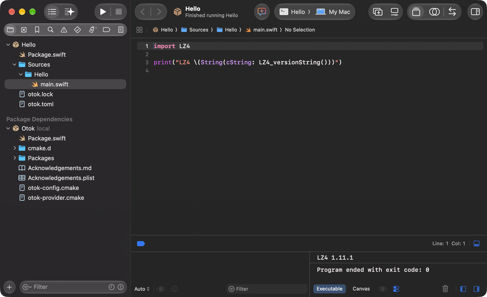

import { Card, CardGrid, Steps } from '@astrojs/starlight/components';

## From otok.toml to Xcode

<Steps>

1. Describe what you ship in `otok.toml`:

   ```toml
   [otok]
   format = 1

   [apple]
   platforms = ["macosx", "ios", "iossim"]
   deployment = { macos = "14.0", ios = "17.0" }

   [deps.lz4]
   recipe = "apotocki/lz4"
   version = "~> 1.10"
   ```

2. Build it:

   ```text
   $ otok install
   otok.lock created:
     added lz4 1.11.1 (r2)
     tool added cmake 4.4.5 (r2)
     tool added ninja 1.13.2 (r2)
     tool added python 3.14.10 (r2)
   ...
   built lz4 1.11.1 for ios-arm64 (3.9 s), 3 of 5 slices
   ...
   packaging lz4 1.11.1 for apple
   output 'Otok': 1 copied, 0 unchanged, 0 removed
   ```

3. Add the directory `Otok` to Xcode once (**File → Add Package Dependencies… → Add Local…**) and use the library:

   ```swift
   import LZ4

   print("LZ4 \(String(cString: LZ4_versionString()))")
   ```

   

</Steps>

The whole walk-through, with Swift packages and CMake: [First project for Apple platforms](/start/apple/).

## Why it is different

<CardGrid>
  <Card title="Your build of every library" icon="setting">
    Not a binary someone built once with their choices: otok builds each library from source for your app, with the
    options you ask for, your platforms and deployment versions, static or dynamic, your C++ standard, your flags and
    your Xcode.
  </Card>
  <Card title="One file says everything" icon="document">
    Libraries, versions, options, platforms, flags and profiles are all in `otok.toml`, and nothing else changes what
    is built: no triplets, overlays or environment variables to read besides it. `otok.lock` pins every input by its
    hash.
  </Card>
  <Card title="Ready for the App Store" icon="approve-check">
    XCFrameworks for every Apple platform and simulator, privacy manifests, checks of required-reason APIs and of
    symbols that would clash with Apple's private libraries, and the acknowledgements of every license.
  </Card>
  <Card title="Nothing touches your Xcode project" icon="apple">
    otok writes one directory, a Swift package you add once. No generated workspace, no build phases. The same project
    builds the same libraries for Android, Windows and Linux.
  </Card>
</CardGrid>

[Browse the libraries](https://otok-dev.github.io/index/) of the public index.
